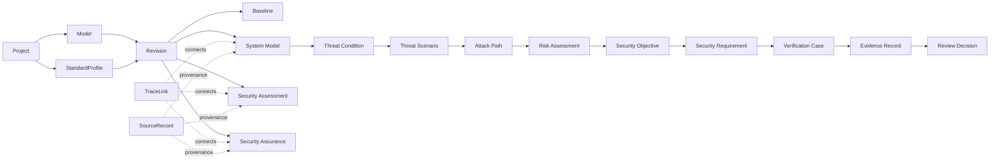

# ASTRA 目标领域模型

- 状态：Accepted（概念模型，合并后校准，尚未实现）
- 日期：2026-10-08
- 重新接受日期：2026-10-09
- 目标：DO-326A/DO-356A 通用适航安保工程辅助核心

## 1. 领域上下文

目标系统划分为六个边界上下文。上下文是代码模块和事务边界的设计依据，不要求与 Neo4j 标签一一对应。

| 上下文 | 职责 | 核心对象 |
| --- | --- | --- |
| Project Governance | 项目、范围、标准配置、角色和基线 | Project, Model, Revision, Baseline, StandardProfile, Assumption |
| System Modeling | 功能、资产、接口、数据流和安保边界 | Function, Asset, Interface, DataFlow, SecurityBoundary, ExternalEntity |
| Security Assessment | 威胁、场景、路径、分析运行和风险 | ThreatSource, ThreatActor, ThreatPoint, ThreatCondition, ThreatScenario, AttackPath, AnalysisMethodDefinition, AnalysisRun, DerivedResult, RiskAssessment |
| Security Assurance | 目标、要求、控制、验证和批准 | SecurityObjective, SecurityRequirement, Control, VerificationCase, EvidenceRecord, ReviewDecision, ComplianceClaim |
| Standards & Adapters | 标准元数据、适用性、导入和工作产品 | StandardDocument, StandardReference, StandardArtifactDefinition, AdapterDefinition, TailoringDecision |
| Provenance & Audit | 来源、追踪、变更和审计 | SourceRecord, TraceLink, AuditEvent, ChangeImpactAssessment, MigrationRecord |

## 2. 顶层关系

图中箭头表示典型业务流，不表示所有对象只能建立一种关系。正式关联使用有类型的 TraceLink 或明确领域关系。

## 3. Project Governance

### Project

项目是最高业务隔离边界，包含：

- 内部 id 和项目 business id；
- 名称、描述和生命周期状态；
- 评估对象和认证/批准上下文摘要；
- 参与者与角色引用；
- 标准 profiles；
- 数据分级和保留策略。

### Model

Model 表达项目内的一个被评估对象：

- `level`：aircraft/system/item 或项目定义值；
- `scope`：范围说明；
- `parent_model_id`：支持层级分解；
- `current_revision_id`；
- `owning_organization`。

### Revision

Revision 是工作区：

- version 为单调递增整数或受控序列；
- 状态为 Draft/InReview/Closed；
- 基于父 revision 或 baseline 创建；
- 所有修改命令使用 expected version；
- 关闭后不再接受写入。

### Baseline

Baseline 是不可变快照：

- baseline id/version；
- source revision；
- content hash；
- standard profile version；
- frozen/approved time and actor；
- approval decision；
- supersedes relation。

## 4. System Modeling

### Function

支持层级分解、分配到资产，以及与安全/安保影响的追踪。

### Asset

Asset 使用通用字段和可扩展分类，不把 BDF/SDF 等标准专用信息直接放入核心：

- name/description；
- category and subtype；
- criticality/classification；
- lifecycle status；
- tags；
- source/provenance。

SystemAsset、InformationAsset 可以使用 subtype、标签或专用子类型表达；最终持久化方式在 Phase 2 详细设计中决定。

### Interface

Interface 是交互位置而不是普通资产边，至少表达：

- 两端或所属元素；
- physical/logical/human classification；
- direction/capabilities；
- exposed/external context；
- crossed security boundaries。

### DataFlow

DataFlow 是有方向、可分类的信息/控制流：

- producer/consumer；
- interface/medium；
- content/classification；
- direction；
- supported functions；
- boundary crossing；
- source provenance。

F3532 BDF/SDF 通过 adapter extension 或 classification 映射到 DataFlow，不决定核心字段集合。

### SecurityBoundary

表达成员、跨越接口、控制责任和边界理由。`TrustBoundary` 作为旧名称进入兼容层。

## 5. Security Assessment

### ThreatPoint

只表达可以被威胁利用或施加影响的位置，包括关联模型元素、暴露类型和适用条件。

### ThreatCondition

表达未授权作用对资产/功能可能造成的状态和影响。至少包括：

- affected elements/functions；
- security attributes；
- operational context；
- effect/severity references；
- assumptions；
- source and review state。

### ThreatScenario

表达具体威胁情景：

- threat source/actor；
- preconditions；
- entry points；
- actions or attack steps；
- target/result；
- triggered/related threat conditions；
- candidate/selected paths；
- existing controls；
- review status。

### AttackPath

AttackPath 是结构化路径，不直接等于 ThreatScenario：

- ordered steps/segments；
- traversed model elements and relations；
- entry and target；
- feasibility/evidence；
- origin：generated/manual/imported；
- AnalysisRun；
- review state。

### AnalysisMethodDefinition / AnalysisRun / DerivedResult

`AnalysisMethodDefinition` 描述一个版本化分析方法，而不是标准本身：

- method id、version 和 maturity（experimental/qualified/deprecated）；
- input/output contract version；
- configuration schema 和 canonicalization policy；
- 支持的对象类型和运行约束；
- 实现/规则包版本和可用性状态。

`AnalysisRun` 和 `DerivedResult` 是标准无关核心实体。AnalysisRun 是所有自动分析的通用执行外壳，绑定 project、revision/baseline、StandardProfileVersion、方法/实现版本、canonicalizer、输入快照、运行限制、执行者、命令和审计入口。方法专用 DTO 保存在版本化 payload/extension 中，不属于通用核心领域模型，也不直接替代核心实体。

`DerivedResult` 保存运行结果及其证据、状态、截断/不确定信息和 supersession 关系。实验结果只能处于 Experimental/Candidate 等机器状态；转换为 ThreatPoint、ThreatScenario、AttackPath 或 RiskAssessment 必须经过显式人工评审和 promotion command。

当前 `FeatureRule`、`FeatureRecord`、`Scope` 和 `Policy` 属于实验方法契约。当前离线路径输出属于 `topology_only` DerivedResult，不等同于核心 AttackPath。

### RiskAssessment

RiskAssessment 绑定：

- assessed subject；
- method/profile/version；
- input values and rationale；
- computed result；
- engineering judgement；
- acceptance decision；
- assessor/reviewer；
- applicable baseline/revision。

DPS 可以成为一个 assessment method 的输入或结果字段，但不定义通用 RiskAssessment。

## 6. Security Assurance

### SecurityObjective

由风险处置需要产生或导入，追踪到 TC/TS/RiskAssessment，并可分配到模型层级。

### SecurityRequirement

要求必须可分配、可版本化、可验证，至少记录：

- statement；
- rationale；
- source objective；
- allocated elements；
- verification criteria；
- status and owner。

### Control

记录要求的实际实现措施，并区分 proposed、implemented、verified、ineffective 等状态。

### VerificationCase

记录验证对象、方法、环境、输入、步骤/分析、接受准则和结果引用。具体测试文件由 EvidenceRecord 管理。

### EvidenceRecord

保存证据元数据、hash、版本、位置、适用范围和审查状态。大型文件可以外置存储，Neo4j 保留受控引用。

### ComplianceClaim

表达一个明确的符合性主张。只有当所需 TraceLink、证据和 ReviewDecision 完整时才能进入 Approved。

## 7. Standards & Adapters

### StandardDocument / StandardReference

保存标准标识和条款引用元数据。标准正文是否存储由授权和项目策略决定，核心不要求持有全文。

### StandardProfile

把标准版本、适用性、裁剪和 adapter 版本绑定到项目/基线。

### AdapterDefinition

adapter 是代码和配置的版本化组合，负责：

- import schema；
- core mapping；
- validation rules；
- generation rules；
- work-product/report projections。

adapter 的输出必须使用核心 application commands 或显式 extension storage，不能修改无关项目。

## 8. Provenance & Audit

### SourceRecord

描述输入资料和定位，不承载业务判断。

### TraceLink

连接不同领域对象并表达明确工程语义。标准目录是共享只读上下文时，允许 Project 实体指向共享 StandardReference；其他业务 TraceLink 默认不跨项目。

### AuditEvent

记录谁、何时、通过什么命令、在什么 revision 上改变了什么。AuditEvent 不可通过普通业务 API 修改。

### ChangeImpactAssessment

比较两个 baseline/revision，沿 TraceLink 和明确领域依赖传播影响，并记录工程人员的处置决定。

## 9. 聚合与事务边界

建议的初始聚合/应用服务边界：

- Project aggregate：项目元数据和标准配置；
- Revision workspace：版本控制和模型写入；
- Model graph service：资产、接口、数据流的结构一致性；
- Security assessment service：TC/TS/path/risk；
- Assurance service：objective/requirement/verification/evidence；
- Review service：review session/comment/decision；
- Baseline service：校验、冻结、摘要和批准；
- Import service：preview + scoped commit；
- Analysis service：AnalysisRun + derived results；
- Traceability service：链接校验、覆盖和断链分析。

不要求把整个 Revision 作为一次加载到内存的巨大聚合。Neo4j 操作可以由 application service 协调多个仓储，但必须共享事务、scope 和 expected version。

## 10. 全局不变量

1. 业务实体必须属于明确 Project。
2. 可变业务实体必须属于明确 Revision。
3. 非共享业务关系不得跨 Project。
4. Approved Baseline 不可更新。
5. DerivedResult 必须引用输入和生成器版本。
6. Approved 状态只能来自人工 ReviewDecision。
7. TraceLink 两端必须存在且版本上下文兼容。
8. 删除/归档不能产生未声明的追踪断链。
9. 报告必须绑定 revision/baseline 和 StandardProfile。
10. adapter 不得绕过核心写入治理。
11. 分析方法 DTO 不得直接充当核心持久化实体。
12. 实验结果晋级必须保留到原 AnalysisRun 和输入证据的追踪。
13. 外部数据声明的审核状态不得在未验证 actor、role 和 subject version 时转换为 ReviewDecision。
14. 晋级核心实体必须保留 origin 和到源 DerivedResult/AnalysisRun 的 DERIVED_FROM 追踪，并对评审与导出可见。

## 11. 当前实现映射边界

目标模型不是要求立即删除现有类型。Phase 1/2 使用兼容映射：

- `AssetNode` 暂时映射到 Asset；
- `AssetEdge` 暂时映射到 generic connection 或 DataFlow；
- `TrustBoundary` 映射到 SecurityBoundary；
- `DO326ALink`/`StandardMapping` 映射到 TraceLink；
- `GraphVersion` 映射到 Revision.version；
- `AttackPath.analysis_batch_id` 映射到 AnalysisRun；
- FeatureRule preview 请求映射为 method-specific input，规则/策略/evidence/scope 保持原契约版本；
- FeatureRule decision 映射为 DerivedResult，不直接映射 ThreatPoint 或 ThreatScenario；
- offline topology trace 映射为 `topology_only` DerivedResult，路径序列保持有序；
- F3532 专用字段继续由 compatibility projection 读取，直至 adapter extension 完成。

任何自动映射存在歧义时，产生 migration issue，不通过名称猜测并写入 Approved 数据。
